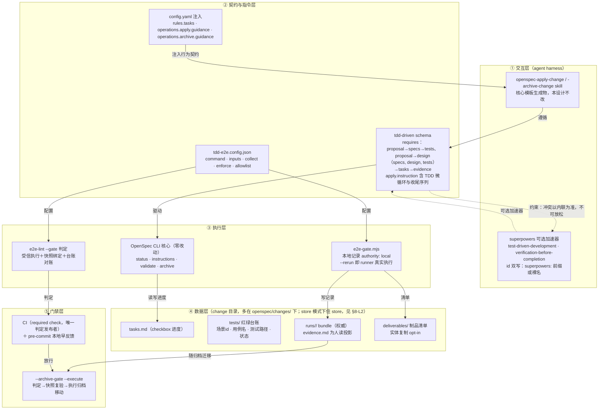
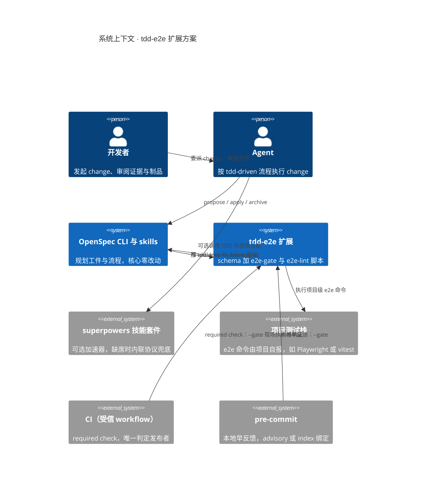
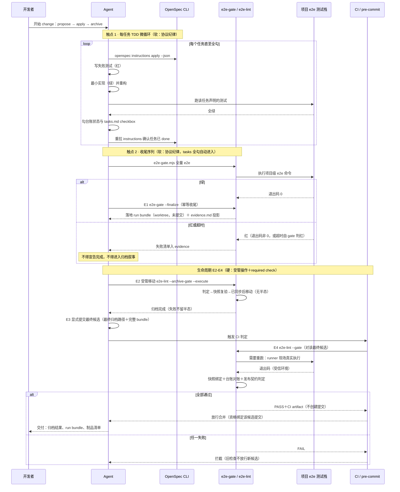
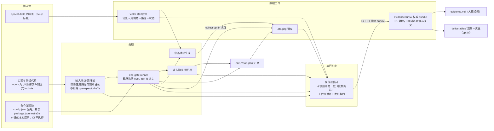
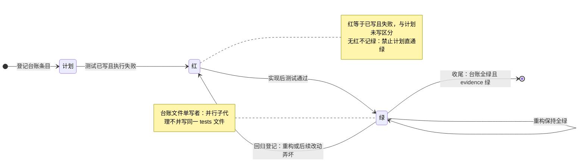
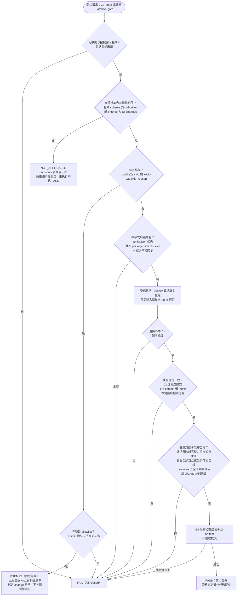

# 设计：OpenSpec TDD 开发流 + 自动 e2e 门禁 + 制品输出（tdd-e2e 扩展 + superpowers 最小桥接）

> 状态：**定稿**（mimo 两轮对抗 + glm 独立二审 + gpt 三轮对抗收敛至"最小剩余集三补丁"并已交付；gpt 第 4 轮因服务网络中断未执行，经用户决定以 3 轮记录定稿）。日期：2026-11-26。
> 交付物：`extensions/tdd-e2e/`（schema + scripts + 技能指令），核心 CLI 零改动；CI runner 模式从 Phase 2 提前进 v1。

## 1. 意图与背景

**目标**：让 OpenSpec 的 change 流程（propose → apply → archive）天然支持：
1. **TDD 开发流程**：实现任务按红-绿-重构微循环推进，先写失败测试再写实现；
2. **自动触发 e2e 测试流**：在固定触点执行 e2e，不靠人提醒——v1 的强度分级见 §6.5（CI 触点是真自动执行，skill 触点是强制协议步骤）；
3. **开发→测试完整覆盖**：需求场景 → 测试用例 → 执行结果全程可追溯（v1 = 规划级逐场景追溯 + 执行级总量判定，见 §8 边界 L1）；
4. **测试通过后输出制品**：e2e 绿灯后产出交付制品（测试证据 + 构建产物清单），作为归档的一部分；红灯禁止输出与归档。

**最小引入 superpowers**：可以引入，且方向已修正（吸收 glm P1-5）——**内联红-绿-重构协议是规范锚，superpowers 技能是可选加速器**，而非"技能为主、缺席降级"。这样正确性永不依赖 superpowers 的存在与版本演进。桥接面 = 指令级组合调用（skill composition）：按 id 引用、双写 id 形态（`superpowers:test-driven-development` / 裸名 `test-driven-development`，随 harness 漂移）、README 写验证方法。不 vendor、不 fork、不锁版本。

## 2. 术语约定（避免撞词）

OpenSpec glossary 明确 **artifact = 规划工件（proposal/design/tasks 等），不是构建产物**。本设计引入两个新词：

| 本设计用词 | 含义 | 落点 |
|---|---|---|
| **测试证据 (evidence)** | e2e/测试执行的机器结果 + 人读报告 + 追溯矩阵 | change 内 `evidence.md`（工件）+ `evidence/`（机器数据） |
| **交付制品 (deliverables)** | 测试通过后输出的交付物：构建产物、打包、覆盖率报告等 | 默认以**清单**（文件名 + sha256 + 大小）记入 evidence；实体复制 opt-in |

另：change 内测试规约工件目录 `tests/`（markdown 规约）与仓库根 `test/`（真实测试代码）是两个东西，instruction 与 README 显式区分。

## 3. 目标 / 非目标 / 反目标

**目标**
- G1 TDD 微循环成为 apply 阶段的默认执行协议（每任务：失败测试 → 实现 → 重构 → 跑测试 → 勾选）。
- G2 e2e 在三个触点自动触发（强度分级）：任务边界（skill 协议步骤，增量测试）、change 收尾（skill 协议步骤，全量 e2e）、**CI/pre-commit（runner 真实执行，硬门禁，v1）**。
- G3 场景→用例→结果三段追溯：tests 工件即**红绿台账**（每用例标注红/绿状态，随实现勾记），evidence 收口回填；lint 按结构化条目校验映射完整。
- G4 e2e 绿灯后输出交付制品清单（实体 opt-in）；红灯或证据陈旧则禁止归档、禁止输出。
- G5 superpowers 以可选加速器形式被组合调用，缺席时内联协议无损兜底。

**非目标**
- 不替换 OpenSpec 的 propose/规划流（brainstorming/writing-plans/executing-plans 与 OpenSpec 规划面重叠，**不桥接**）。
- 不在 v1 做核心 CLI hook/事件总线/workflow-run 模型（`docs-lab/reference/architecture/workflow-runs.md` 空页留给 Phase 2）；但把其"真实执行"切片以 **runner 模式**（扩展脚本内实现）提前进 v1。
- 不做代码覆盖率强制阈值（只收集与呈现）。
- 不做执行级逐场景追溯（不验证"矩阵里的每个测试真被执行"——v1 校验映射完整性 + 总 exit code，见 §8 L1）。
- 不自动唤起 agent 修复整单 e2e 失败。是否增加有上限的本地修复 loop，由 §7.1 试点决定。
- 不接管项目的测试栈（命令由项目自报，本设计只负责触发与取证）。

**反目标（做出来即失败）**
- 让默认 `spec-driven` 用户感知到任何流程变重（全部能力 opt-in）。
- 依赖未被 OpenSpec 测试/版本管理的外部 schema 内容（社区 `superpowers-bridge`、`anvil` 只借鉴思路，不引入代码）。
- e2e 证据可造假通过门禁（权威判定必须来自 CI 内真实重跑，见 §6.3 信任模型）。

## 4. 约束（来自当前工程现状，已核实）

1. **Schema 即扩展点**：`schema.yaml`（artifacts 图 + `apply.tracks` + instruction）三级解析（project → user → package，`src/core/artifact-graph/resolver.ts:133-181`）；`generates` 支持 glob（`outputs.ts:335-375`）；`apply.tracks` 不匹配仅告警并触发回退，各命令面回退行为不完全一致（`schema.ts:110-130`）。
2. **config.yaml 注入是 prompt 级行为契约**：`context` / `rules.<artifact>`（只进规划期工件 instruction）/ `operations.<op>`（**必须是对象且含 `guidance: string[]`**；非对象整体丢弃，对象内未知额外字段告警后仍保留合法 guidance——`src/core/project-config.ts:159-186`）。apply 期 agent 只见 `context + operations.apply.guidance + apply.instruction`（`instructions.ts:554-563`）。
3. **无 hook/事件机制**：CLI 是 agent 调用的一次性进程；硬触点只能是外部接线（`openspec validate --archived` 进 pre-commit 先例、lint 脚本进 CI）。
4. **tasks 语义已半支持 TDD**：任务必须声明验证方式；0-checkbox 的 tasks.md = "没有工作"，archive 对 0-task 静默放行（`archive-change.ts:123`），validate 仅告警（`validator.ts:620`）——**门禁不能锚定 checkbox 状态**。
5. **x- 键是官方扩展机制**：`x-*` 顶层键核心忽略且不报 unknown（`change-metadata.ts:20-31`）；但 `.openspec.yaml` 被核心定性为 untrusted data（`change-metadata.ts:50` 附近），把其键当命令执行是显式信任决策（见 §6.3）。
6. **skills 是生成物**：改 skill 模板即核心变更且被 `openspec update` 覆盖（customize/skills.md Parked Gap）——扩展自带指令走 schema instruction / config 通道，不动 skill 模板。
7. **archive 整目录移动**：deliverables 随归档走（`core/archive.ts:360-500` copyDirContents 递归整树；命名 `YYYY-MM-DD-<name>`）；现成内容指纹先例 `fingerprintDirectoryContents`（`archive.ts:390-470`）。
8. **experience-loop 是全链路先例**：schema + 3 脚本 + install 不自动改 config + "CI 各项目自行接线"约定 + `test/extensions/` 测试；其 lint 执法蕴含式（`if (schema !== 'experience-loop') return`）、`x-skip-retro` stub 豁免（蕴含式执法 + typo 键诊断）、retro 工件"勿提前创建"权威条款、store 模式边界 #5，全部可复用。
9. **社区先例**：`superpowers-bridge`（OpenSpec 工件治理 × superpowers 执行技能 + evidence-first retrospective）；`anvil`（`proposal→specs→design→review→test-plan→tasks→apply→verify`，"test-plan maps every spec scenario to a named test and doubles as a red/green ledger"——即 tests+evidence 的组合，红绿记账思想直接借鉴）。官方均免责不测试/不版本。
10. **本仓 CI 现状**：ci.yml 不跑任何 openspec 命令——tdd-e2e 的 CI 接线是本仓第一个硬门禁（新惯例，需显式任务含 docs-only 路径过滤）；`package.json` **无 `test:e2e` script**（dogfood 须先补）。

## 5. 候选方案（Approaches）

### A1. config-only 注入（零新增文件）
只用 `config.yaml` 的 `rules`/`operations` 注入 TDD 与跑 e2e 的行为契约。
- ✅ 最轻。 ❌ 无 tests/evidence 工件承载追溯与证据；无结构化制品输出；纯 prompt 软约束；门禁无从谈起。**弃（可作 A2 增强层）。**

### A2. 扩展包 + 新 schema + superpowers 桥接【选定】
仿 `experience-loop` 落 `extensions/tdd-e2e/`：`tdd-driven` schema + scripts（install / e2e-gate / e2e-lint）+ 桥接指令 + README。核心 CLI 零改动。
- ✅ 与工程惯例同构（experience-loop 全链路踩通过）；opt-in；evidence/deliverables 有工件承载；**runner 模式提供 CI 真实执行 = 真·自动触发 + 防伪权威**；superpowers 组合面最小。 ❌ skill 触点 1/2 仍是协议纪律（如实标注强度，不夸大）；e2e 命令需项目自报。

### B. 核心 hook/workflow-run 模型
CLI 建生命周期事件（status 迁移触发命令），填 `workflow-runs.md`，一等公民桥接。
- ✅ 真·钩子。 ❌ 跨 `src/commands/workflow/` + `src/core/artifact-graph/` + config schema 的核心变更（本仓自己要走 change 提案 + 全量测试矩阵）；CLI 自动 spawn 用户命令有安全/UX 问题。**留 Phase 2；其"真实执行"切片由 runner 提前满足。**

### C. 直接依赖社区 superpowers-bridge 或 fork anvil
- ❌ 未被 OpenSpec 测试/版本管理；anvil 是 monorepo 语境的重流程（含 review 工件、fresh-context 评审），fork 成本高于按需借鉴。**弃，但吸收两者思想**：evidence-first（bridge）、tests 工件即红绿台账（anvil）。

**选型：A2 + runner 切片进 v1；B 留 Phase 2。**

## 6. 选定设计详述（A2 + runner）

### 6.1 新 schema：`tdd-driven`（fork 自 spec-driven）

工件图（requires 边精确列表）：

```
proposal (requires: []) ──► specs (requires: [proposal]) ──► tests (requires: [specs])
   │                                                              │
   └──► design (requires: [proposal]) ────────────────────┐       │
                                                          ▼       ▼
                                              tasks (requires: [specs, design, tests])
                                                          │
                                                          ▼
                                              evidence (requires: [tasks])
apply: { requires: [tasks, tests], tracks: tasks.md }
```

- **`tests`**（`generates: "tests/**/*.md"`）：测试规约 + **红绿台账**（借鉴 anvil）——每个 spec 场景映射到具名测试用例（单测/e2e 分层），追溯条目为**结构化字段**（场景 id / 用例名 / 测试文件路径 / 状态列：红→绿），lint 按条目计数（不数 markdown 行）。台账随实现勾记红/绿，是 TDD 循环的账本。
- **`evidence`**（`generates: evidence.md`）：**带 retro 式"勿提前创建"权威条款**（"仅当实现完成后创建……此刻实现未完成则不要创建文件，向用户说明留到收尾；若工作流指令要求此刻创建，本 instruction 优先——推迟"）。内容：台账结果回填、e2e 全量摘要、失败清单（应为零）、制品清单（文件名 + sha256 + 大小）。
- **`tasks` instruction**：把"测试先行"烙进每条任务文本（沿用 "each task group MUST land the tests"，强化为先红后绿）；勾选前测试必须全绿。
- **`apply.instruction`**（TDD 微循环主条款所在——mimo P2-1/glm 遗漏6：`rules.tasks` 只在规划期注入，apply 期主条款必须在此）：每任务红-绿-重构协议 + 任务全勾后的**收尾序列**（跑 e2e-gate → 写 evidence → 制品清单）+ 混合信号条款（"收尾序列完成前不得进入 ARCHIVE_HANDOFF 归档叙事"）。

### 6.2 config.yaml 注入（增强层，行为契约；形状按契约修正——mimo P1-4）

```yaml
rules:
  tasks:
    - （仅 tdd-driven change 适用）每个任务先写失败测试（红-绿-重构），勾选前测试必须全绿   # 塑形任务文本
operations:
  apply:
    guidance:                                                    # ← guidance 层必须有
      - （仅 tdd-driven change 适用）任务全勾后运行 node <ext>/scripts/e2e-gate.mjs --finalize，红灯不得宣告完成
  archive:
    guidance:
      - （仅 tdd-driven change 适用）归档走受管入口 e2e-lint --archive-gate --execute，未过判定不得归档
```

**适用性限定（gpt P1-6）**：config.yaml 注入**不按 schema 过滤**——`rules.tasks` 只在规划期塑形任务文本（对普通 spec-driven change 无害），但 `operations` guidance 会进入所有 change 的 apply/archive 流程。推荐片段的 guidance 文本必须以"（仅 tdd-driven change 适用）"开头；主承载在 schema instruction（只对 tdd-driven 渲染），config 注入只是可选补充。

### 6.3 证据信任模型与脚本（核心安全设计）

**判定语义（安全属性，实现须逐字遵循，勿下沉 builder）**：
- **发布资格 = 受信执行成功 ∧ 快照绑定一致 ∧ 台账/发布契约通过**。退出码只回答"本次测试是否通过"，不是放行的充分条件；三项全过才是绿。
- **每一次放行判定都在判定进程链内真实执行（runner 重跑）**，不存在"凭历史记录放行"的路径。
- **`authority` 字段仅记录执行环境（ci/local/pre-commit），永不参与判定**。机器记录只是溯源/诊断，不是通行证；本地 gate 红灯报告有诊断价值，照常写入并标 `authority: local`。
- **豁免是独立结果（EXEMPT）**，绑定受信授权记录（见下），不与测试绿混记。

**契约一 · CI 判定发布契约（谁发布 CI 判定——权限/执行契约，gpt N2/P0-2）**：
- **受信 workflow 是唯一判定发布者**，隔离要求写成可测权限契约：候选侧**无写权限**于判定器、策略文件、受信结果目录与 required-check 发布通道（独立 job 或受限子进程：不同用户/只读挂载判定器/无网络凭证）；受信侧观察真实退出与超时。
- **实际启动命令来自固定的受信定义**（受信 wrapper 或绝对化命令串），**不在候选 checkout 按脚本名重新解析**（防 `test:e2e` 名义与实际执行脱钩）。
- 命令与策略解析只读受信版本：`command`/`test:e2e`/`enforce`/`allowlist` 全部读自**默认分支版本**的 `tdd-e2e.config.json` 与 `package.json`；候选 checkout 只提供被测代码与测试。审批绑定**确切版本 hash**。
- 候选测试及其输出只能影响测试结果，**不能自行签发结果**；runner 证明"跑过且退出码为 0"，不证明测试强度（语义质量靠 code review）。
- gate 结果接入 PR 与 merge queue 的 **required checks** 聚合：缺失、被取消、配置不可读一律**不等于通过**。
- **pre-commit 只提供本地退出状态**：不发布合并检查，不产生可替代 CI 的凭证。

**契约二 · 发布对象契约（哪个对象原子提交——gpt N3/P0-1）**：
- **单一不可变 run bundle**：`evidence/runs/<run-id>/` 内含 e2e-result.json、人读报告、台账快照、受控大小的制品清单与摘要（完整日志与实体走 CI artifact（带保留期），git 内不累积大文件）、命令与策略标识、输入键投影。
- `evidence.md` 顶层文件为**人读投影**（引用最新批准 run-id），非权威；Git 持久化 ≠ 运行证明——权威判定始终是判定进程链内的独立重跑。
- **受测快照**（被测输入树）与**发布提交**（含 bundle 与最终归档路径的候选提交）分开命名、分别记录。

**生命周期四事件（一条生命周期，gpt P0-1 定案）**：
1. **E1 本地收尾**：`--finalize` 暂存 → 完整落地本地 run bundle（worktree 内，**未提交**）；
2. **E2 受管移动**：`--archive-gate --execute`（已同步后移动，见契约三）；
3. **E3 最终候选提交**：开发者**显式提交**含最终目标路径与整个 bundle 的树——合并资格只绑定这一个提交；
4. **E4 CI 判定**：`--gate` 对**该最终候选**重跑并发布 required check 与 CI artifact（**不创建提交**）。
- 已有绿检查后移动/修改任一 bundle 文件 = 新候选，旧检查**不放行**（验收用例）；允许早提交 bundle，但它只是中间提交，不继承最终放行。

**契约三 · 归档契约（谁执行归档——gpt N1/P1-1）**：
- `e2e-lint.mjs --archive-gate --change <name> --execute` 持有移动，语义是"**已同步后移动**"（非 `openspec archive` 的语义等价物）：①完整判定（含重跑）→ ②**快照复验**（受测快照 == 当前受检树）→ ③移动阶段无半态（目标预检、同文件系统/no-clobber、保留日期前缀语义对齐 `archive.ts:1654-1679`、复验到移动间持文件锁防并发写入）→ ④移动失败回退不留半态（对齐核心 rename 回退先例 `archive.ts:492-500`）。
- delta→主 spec 的 sync 是 agent 前置工作：**先行 sync 的残余状态明示**——门禁失败会留下"主 specs 已更新、change 仍在途"，恢复责任 = 修复后重跑或回滚 sync（命令校验 sync 完整性，部分完成 = 报错中止）。
- 原生 `openspec archive`、archive skill 直接 mv、手工移动**不在本地强制范围**（`archive-change.ts:60-99` guidance 可选）；受保护分支 required check 验收归档提交兜底（残余 §8-R14）。"任何原生路径不可绕过"需核心钩子 = Phase 2，本期不承诺。

**快照绑定（gpt P1-1/N5）**：
- CI：绑定**候选提交**（checkout 即被测对象，重跑即测即判）；
- pre-commit：固定 **index 树**（`git write-tree`/checkout-index 到临时快照目录）在独立快照执行，受检树执行前后校验不变；测试栈无法脱离 worktree 时**明示降级 advisory**（不修改 index，不声称强快照）；
- 本地收尾：gate 运行**前后各算一次输入指纹**，不一致 = 运行无效、作废重跑；发布前再比对一次；
- **本地硬路径冻结**：运行输入、台账、`.openspec.yaml` 元数据、策略标识一并进 run bundle 输入键；
- 输入指纹 = 对输入根做内容 tree-hash（EOL 归一化仅适用文本）：默认 = 全部 git 跟踪文件 ∪ 显式 `include`（未跟踪输入须显式声明，否则不受测并告警）；排除**精确生成路径**（change 内 `evidence/`、`deliverables/`）与规划目录（`openspec/changes/`、`openspec/specs/`、`openspec/experience/`）；**不排除 `openspec/tdd-e2e/`（runner 自身必须入指纹）**；symlink 默认拒绝（可配置按目标哈希）；字节敏感文件不做 EOL 归一化。
- **输入键投影（带版本，gpt P1-2）**：输入键 v1 = {仓库根业务/测试输入，规划根 delta/台账/元数据，策略版本 hash}；**精确排除**生成记录（`runs/`、`evidence.md` 投影、`.staging/`）与授权记录本身；**从最终候选重算并比对**。语义区分："内容一致 ∧ CI 独立重跑" ≠ "本地记录真实可信"（Git 持久化不是运行证明）。EXEMPT 授权投影单列（授权条目规范化哈希）；**移路径（归档移动）与业务内容变化均使授权失效**。

**命令发现链（命令来源是信任决策；只读受信版本——契约一）**：
1. 受信 `tdd-e2e.config.json`——**runner 权威执行只认这一级**；
2. 受信 `package.json` 的 `test:e2e` script（项目级等价）；
3. change 级 `.openspec.yaml` 扁平点号键：`x-tdd-e2e.command` / `x-tdd-e2e.skip` / `x-tdd-e2e.skip_reason`（顶层 `x-*` 命名空间内，唯一 YAML 样例入 README）——**仅作本地覆盖提示，CI 不执行**；lint 对"与项目级不一致"告警，对近似键（`x-tdd-e2e_skip`、裸 `skip_reason`）typo 诊断。
- 全空且无显式豁免 → fail-closed。

**判定表（一份判定表——gpt P1-3）**：
- **三态输出分离**：项目执行状态（项目级 e2e）/ 逐 change 状态（场景对账）/ **唯一聚合结论**（required check 只发布聚合，取最差项）。
- **`skip_specs` 只免场景对账**，测试豁免另走 EXEMPT 授权（纯代码重构用 `skip_specs` 不得免项目级 e2e）。
- 元数据编辑规则：**新建 change 自带 schema/元数据 = 合法**；修改既有 change 的 schema/豁免字段 = 须授权记录，未授权 = FAIL。
- 真值表：

| 情形 | 项目级 e2e | 逐 change 对账 | 聚合结论 |
|---|---|---|---|
| docs-only（diff ⊂ 文档路径） | 免重跑（记 SKIP-EXEC，**非 PASS**） | 免 | 无在范围 change → NOT_APPLICABLE |
| code-only（无 change 目录变动） | **必须重跑**（inputs 覆盖全仓） | 空集合 → 无对账项 | 重跑绿才 PASS |
| 涉 change（新增/迁移/删除/触碰） | 必须重跑 | 按身份决策表逐 change | 聚合取最差项 |
| EXEMPT（有效授权） | 免重跑（凭授权记录） | 可继续（bundle 标记豁免） | EXEMPT（独立结果） |
| merge queue | 同涉 change | 合成结果 vs 目标分支基线 | 同上 |

- 逐 change 身份决策：新增（按新身份）、迁移（按迁移后身份）、删除（须确认清理完整）、空集合记 NOT_APPLICABLE；"未执行"永不记 PASS。显式 schema 覆盖只认受信输入。

**EXEMPT 授权（gpt N6）**：权威判定读取**受信授权记录**（受保护分支 allowlist 文件条目：仓库/规划根＋change 稳定身份＋受审快照 hash＋范围＋批准人）；glob 只筛候选不作授权。授权随受审快照变化失效；修改豁免原因 = 新授权。stub 只记录结果不证明资格。受管归档可凭有效 EXEMPT 继续但 bundle 标记豁免（可审计）；授权校验失败 = FAIL。

**收尾入口幂等（gpt N7/P1-4）**：`openspec instructions` 在 `all_done` 返回硬编码提示而非 schema instruction（`instructions.ts:647-679`），故收尾序列**不寄托于 apply.instruction 自动恢复**（其条款仅 ready 阶段可见，留作软协议）。**权威收尾入口 = `e2e-gate.mjs --finalize --change <name>`**，幂等语义：
- **两态**：`本地收尾完成`（bundle 落地 worktree、未提交）与 `已提交待 CI 验收`（E3 之后）；
- **复用条件**：仅**同输入键 v1＋完整＋成功＋通过清单校验**的本地 bundle 可复用；红灯、损坏、未提交残片、仅元数据变化（键含元数据 → 键变）→ 不复用，新 run 或修复重建；
- 失败重试不留半态（staging 清理）；"发布成功但进程未返回" = 重跑 finalize 幂等恢复；"发现未提交 bundle" = 校验后复用或废弃重建；
- **权威 gate 独立重跑，不凭收尾标记放行**。
- schema `apply.requires` 显式加 `tests`（`requires: [tasks, tests]`）；零任务/skip_specs 处理见 README。

**覆盖对账（gpt P1-5/N8）**：
- 与核心解析对齐（`requirement-blocks.ts:794-816`：场景 = requirement 下 h4 子标题；delta 仅"可消费路径"计入）；
- **场景主键** = 能力路径＋需求名＋场景名；核心允许同名场景（`requirement-blocks.ts:687-708` 多重性语义）——v1 扩展**拒绝重名并给诊断**（fail-closed，不引入稳定 ID）；
- 映射语义：一场景一条映射条目，条目内**允许多个用例**（单测＋e2e 分层）；
- 对账 = 逐场景映射完整，拒绝未知引用；无 delta / 零场景显式分类（按 `skip_specs` 判 NOT_APPLICABLE 或 FAIL）；
- 红→绿历史不可证：保留 L1 口径（开发协议，CI 不证明历史顺序）；审计 test-first 留 Phase 2。

**执法蕴含式（enforce 语义）**：锚定**有效 schema**（显式覆盖 → change 元数据 → 项目默认 → `spec-driven`；`change-metadata.ts:248-297`；显式覆盖只认受信输入）——有效 schema 为 `tdd-driven` ⇒ 必须有绿证据；0-task change 同样受限。**元数据无效 = FAIL**（独立错误路径）。`enforce: "all-changes"` = 全员收测试门禁（gate/lint），但不要求无 tests 工件的 schema 补台账。豁免走 EXEMPT 授权（上文）；CI strict（默认）下无授权的 skip = FAIL。

**脚本（`extensions/tdd-e2e/scripts/`）**：

| 脚本 | 职责 |
|---|---|
| `install.mjs` | 落位 schema → `openspec/schemas/tdd-driven/`、脚本 → `openspec/tdd-e2e/`、打印 config.yaml 建议片段（含 `guidance:` 形状与"仅适用 tdd-driven change"限定语；不自动改 config） |
| `e2e-gate.mjs [--finalize]` | 运行协议：前后输入指纹、run-id、staging→单提交发布 run bundle、`authority: local` 记录、超时=红；`--finalize --change` 为**幂等收尾入口** |
| `e2e-gate.mjs --rerun` | runner：受信环境内真实执行 e2e（隔离子进程）——真·自动触发点＋防伪权威 |
| `e2e-lint.mjs --gate` | **唯一权威判定入口**：受检集合决策表 → EXEMPT 授权 → 按需重跑 → 发布资格判定（受信执行＋快照绑定＋台账对账＋发布契约） |
| `e2e-lint.mjs --archive-gate --execute` | **受管归档操作**：判定 → 快照复验 → 执行归档移动（sync 完整性前置校验），失败不留半态 |

### 6.4 superpowers 最小桥接（内联为锚，技能为加速器）

| 流程点 | 规范契约（内联，底线） | 可选加速器（可加严/补充，不可放松） |
|---|---|---|
| 每任务实现 | 红-绿-重构三步微协议 | `superpowers:test-driven-development`（双写：裸名 `test-driven-development`） |
| change 收尾取证 | 先跑命令拿证据再宣告完成 | `superpowers:verification-before-completion` |
| 分支收尾（可选） | 省略，走项目合并流程 | `superpowers:finishing-a-development-branch` |

- 桥接规则：按 **id 引用**（双写形态，README 写"如何确认技能可用"验证方法），不复制内容、不 vendor、不锁版本；**技能存在与否不影响正确性**（协议在内联文本里）。
- **冲突裁决（第 2 轮 D3 修正）**：内联协议是底线，技能可加严/补充、**不可放松**；技能与内联冲突时**以内联为准**。"技能只会更严"不是可保证的事实，正确性不得押注在外部技能的演进方向上。
- **不桥接** brainstorming/writing-plans/executing-plans（规划面重叠，桥接即产品自噬）。
- 子代理并行 TDD（`subagent-driven-development`）可用于并行任务，但 evidence/台账收口串行（收尾序列单一写入点，防并行争写）。

### 6.5 自动触发模型（三触点，强度如实分级）

```
任务边界（skill 协议步骤）── 增量测试，绿才勾选                    [软：协议纪律]
        │ tasks 全勾（权威入口 e2e-gate --finalize，幂等）
        ▼
E1 本地收尾 ── --finalize ── 绿 ──► 落地 run bundle（worktree，未提交）
        │                        └─ 红 ──► 停，失败清单入 bundle，不得宣告完成
        ▼
E2 受管移动 ── --archive-gate --execute（已同步后移动，无半态）      [硬：受管操作]
        ▼
E3 最终候选提交 ── 开发者显式提交（最终归档路径＋完整 bundle）  [合并资格绑定此提交]
        ▼
E4 CI 判定 ── --gate 对最终候选重跑 ──► required check＋CI artifact   [硬：唯一发布者]
```

"自动"的诚实口径：**E4 是真·自动执行与权威门禁**，且只有接入 required checks 才是合并硬门禁；**合并资格绑定 E3 最终候选提交**（旧检查不放行移动/修改后的新候选）；pre-commit 是本地早反馈（仅退出状态，不发布检查、不产生凭证）；归档强保证只覆盖**受管移动**（原生 CLI/skill/mv 不在本地强制范围，§8-R14）。触点 1/2 是 skill 强制协议步骤（prompt 级契约）。Phase 2 若建 workflow-run 模型，E1/E2 可升级为 CLI 事件触发/核心钩子。

### 6.6 制品输出（deliverables）

- 绿灯后默认产出**制品清单**（文件名 + sha256 + 大小）记入 evidence.md「制品清单」节；
- 实体复制 opt-in（`collect` glob 显式配置才复制进 `deliverables/`，README 建议配 .gitignore——防仓库膨胀，glm P1-3）；
- **发布（gpt P0-1/N3）**：`.staging` 暂存防半态，E1 校验后落地 `evidence/runs/<run-id>/` bundle；**交付提交点 = E3 最终候选提交**（含最终归档路径与完整 bundle）；E4 CI 判定不创建提交；
- **体积与可取回**：git 内只留受控大小的清单与摘要；完整日志/实体走 CI artifact（带保留期）；实体以**可取回＋摘要校验**为准，不可取回 = 制品契约不满足（FAIL）；
- 归档时 deliverables/ 清单与证据随 change 移入 `archive/YYYY-MM-DD-<name>/`，成为可审计交付记录（指纹即审计）；
- 红灯或快照绑定失败：清单不产出/标记失效，e2e-lint 拦截归档。

## 6.7 图形总览（模块分层 / 上下文 / 时序 / 数据流 / 状态机 / 门禁判定）

> 以下 6 图与 §6 正文逐条对应，是设计语义的另一种投影；图形与正文冲突时以正文为准。校验记录见本节末。

#### 图 1 · 模块分层架构图（各层职责与改动边界）



正文对应：交互层桥接规则 §6.4；契约层 §6.1/§6.2；执行层脚本表 §6.3；数据层术语 §2、制品 §6.6；门禁层判定语义 §6.3、触点 §6.5。改动边界：核心 CLI 零改动、skill 模板不改，全部增量在 L2 配置与 L3 扩展脚本。

#### 图 2 · 系统上下文（方案与外部系统边界）



#### 图 3 · 时序交互图（三触点生命周期，对应 §6.5）



#### 图 4 · 数据流图（证据、台账、制品的产生与汇流）



正文对应：追溯三段（G3、§6.1 tests）；指纹/快照绑定（§6.3）；发布对象契约（§6.3 契约二：run bundle 单 git 提交原子落地）；放行判定（§6.3 判定语义）。lint 对账口径 = 逐场景映射完整性（§6.3 覆盖对账）。台账不驱动 runner 执行（边界 L1）。

#### 图 5 · 红绿台账状态机（§6.1 tests 工件，状态语义见 §9 注意事项 2）



#### 图 6 · 门禁判定流程（fail-closed 决策树，对应 §6.3）



#### 图形校验说明

**校验方式**：
1. 语法：抽取全部 mermaid 块逐块跑 `mermaid.parse`（mermaid 11，jsdom 无头环境），并由独立评审 harness 补跑 `mermaid.render`（jsdom + SVG 测量桩），6/6 双通过；
2. 语义：mimo 专家逐图对照 §2/§4/§6.1–§6.6/§8/§9 做准确性与完整性交叉核对，并核实事实项（`openspec-apply-change` skill 名、`openspec instructions apply --json` 命令形态、`fingerprintDirectoryContents`（archive.ts:407）先例、Scenario 计数来源）均属实。

**结论**：初检有条件合格；按下列发现修订后**合格**（修订后复验 6/6 通过）。

**必修项（已修）**：
1. 图 1 schema requires 链错边（多画 `tests→design`、漏 `proposal→design`）→ 改为精确 DAG 文案；
2. 图 4 `台账→runner` 边与边界 L1（不做执行级逐场景追溯）冲突 → 删除，台账只入判定不驱动执行；
3. 图 4 指纹节点缺排除/覆盖语义 → 补"覆盖未提交改动；排除 openspec/、evidence/、deliverables/"；
4. §8-R1 第 1 轮遗留措辞（"lint 只认 authority: ci 证据"）与 §6.3 判定语义矛盾 → 以 §6.3 为准修订（authority 仅记录、放行认重跑退出码）。

**同步吸收（P2）**：superpowers 约束边（冲突以内联为准）与 id 双写标注；config.yaml "经 agent 转达"边向；时序超时语义（gate 判红）与开发者消息补全；数据流分层（台账归数据工件）、命令发现链三层、collect 实体复制由 runner 执行；台账单写者注；allowlist 的 CI strict 默认注；store 模式注（§8-L2）；图 2 拆分开发者与 Agent 两个角色。

**未入图（以正文为准，README/正文承载）**：lint 告警类检查（trivially-green 命令、diff 落 inputs 外、typo 键诊断）不拦截仅提示；skip 豁免完整时序（判定分支见图 6）；docs-only 路径过滤（§7/§9-5）；evidence"勿提前创建"条款（§6.1）。

**渲染器兼容提示**：图 2 用 C4 系列、图 5 用 `stateDiagram-v2` 与 `direction` 指令，需支持 C4 与 mermaid ≥9 的渲染器。

**第 3 轮（gpt 对抗）后同步修订**：图 2（CI 为 required check）、图 3（受管归档入口与单入口判定，修正原生 mv 消费者）、图 4（快照双指纹比较两端＋`.staging` 原子发布）、图 6（三出口 PASS/EXEMPT/NOT_APPLICABLE＋判定顺序重排）；修订后 mermaid parse 复验通过。

## 7. 与当前工程的衔接

- **dogfood**：本仓补 `test:e2e` script（包装 `test/cli-e2e`），试点 change 用 `tdd-driven` 跑全链路；
- **不侵入**：`spec-driven` 默认面不变；三个待归档 skills change 不受影响；experience-loop 本期不组合（图可合，但 instruction 文本、install 落位、两套 lint 接线会打架，组合需合并 fork——留后续）；
- **CI 接线**（本仓第一个硬门禁，显式任务）：ci.yml 加 **`e2e-lint --gate` 单入口**步骤（受信 workflow，入 required checks；docs-only 免重跑不免判定）；README 给 GitHub Actions / pre-commit 样例；
- **文档**：docs-lab 增补 tdd-e2e 页 + glossary 增补 evidence/deliverables 词条。

### 7.1 修复 loop 试点

**达成标准**：预先约定的每项验收条件都要有与同一最终候选提交对应的证据，才能宣告目标达成。机器可判定的条件由门禁检查，其余由人验收并记录。缺证据或验收失败时，change 保持未验收。场景映射和整套 e2e 的退出码不证明每个具名测试都执行过（§8 L1）。

**v1 失败路径**：整单 e2e 红灯时保留失败诊断，不放行受管归档或受保护分支合并。修复后显式重跑 `--finalize`，CI 仍对最终候选提交独立验收。

1. **验证门禁。** v1 落地后，用一处可复现的回归验证红灯拦截。修复后重跑，确认新候选通过验收才放行。
2. **观察真实 change。** 用已有 run ID 和失败摘要记录 agent 是否自行继续修复，以及是否需要人重新唤起。
3. **判断是否重开议题。** 两个独立的 change 都出现「问题可复现且能在现有授权范围内修复，但 agent 停下等待人工唤起」时，再设计有上限的本地修复 loop。同一 change 的多次失败只算一个。缺权限、需求不清、外部服务不可用不计入。没有观察到可修复的红灯时，证据不足，保留待评估结论。

待办：[todo-002](../../../issue/todo-002.md)。

## 8. 风险、边界与缓解

| # | 风险/边界 | 级别 | 缓解 |
|---|---|---|---|
| R1 | agent 跳过 e2e 直接勾选/宣告完成 | P0 | 触点 3 runner 是真执行（不依赖自觉）；发布资格 = 受信执行＋快照绑定＋台账/发布契约（§6.3）；未收尾即被受管归档入口拦下 |
| R2 | 证据陈旧造假（改代码用旧绿报告） | P0 | 快照绑定：CI 绑候选提交、pre-commit 绑 index、本地运行前后双指纹（§6.3）；不一致即作废 |
| R3 | 手写 JSON / `command: true` / skip 自助豁免 | P0 | 判定只认进程内真实重跑退出码（手写 JSON 无从放行）；change 级命令 CI 不执行；skip 需 reason + allowlist；lint 对 trivially-green 命令（`true`/`echo`）告警 |
| R4 | 项目没配 e2e 命令 | P1 | 发现链全空 → fail-closed + 配置指引；显式 `x-tdd-e2e.skip` stub 豁免 |
| R5 | e2e 慢/超时 | P1 | 增量触点只跑任务测试；全量仅收尾一次；**超时 = 红** |
| R6 | superpowers 技能不存在/漂移/查不到 | P1 | 内联协议是规范锚（正确性不依赖）；id 双写 + README 验证方法 |
| R7 | 并行任务争写 evidence/台账 | P2 | 收尾序列单一写入点，串行收口 |
| R8 | "artifact" 撞词 | P2 | §2 术语表全文统一 |
| R9 | experience-loop 组合复杂化 | P2 | 本期不组合（措辞已从"天然可合"降级） |
| R10 | 静态 fork 的 schema 漂移（核心 instruction 修复不传播） | P2 | parity 测试（对齐 `regen:parity-hashes` 先例）或 install 时基于已装 spec-driven 生成 |
| R11 | deliverables 实体进 git 膨胀 | P1 | 默认清单制，实体 opt-in + gitignore 指引 |
| L1 | **边界**：v1 追溯是规划级逐场景 + 执行级总量（exit code），不验证"每个具名测试真被执行" | — | README 已知边界明示，避免用户误以为执行级追溯 |
| L2 | **边界**：store 模式（change 住 store，planningHome.root ≠ 项目根）下 gate 跨双根取证；且"CI 权威"无落点（change 在 store、代码在项目根时 runner 跑在哪仓 CI？） | — | 沿 experience-loop 边界 #5 记录；gate 以 planningHome.root 定位 change，指纹根取项目根；store 模式硬门禁需双仓接线，否则降级为本地 advisory（残余风险登记） |
| L3 | **边界**：skill 触点 1/2 是 prompt 级契约 | — | 与 OpenSpec 全产品执法模型一致（apply-change.ts:80 承认），触点 3 兜底 |
| R12 | 换 schema / 删改 `.openspec.yaml` 元数据即让 lint 整体不适用（schema 绕行，mimo 第 2 轮 N-P1-1） | P1 | 项目级 `enforce: "all-changes"` 可全管；lint 对 schema 与项目默认不符且无说明打警告；**残余**：`enforce: tdd-driven-only` 时元数据编辑可脱管，最终边界同 R13 之 code review |
| R13 | 命令配置即最终信任边界：PR 把 `tdd-e2e.config.json` 的 command 改成 `true`，runner 也跑绿 | P1 | **技术无解（与改 package.json scripts 同级），接受并明示**：信任边界是 code review＋受保护策略源（§6.3 信任边界）；lint 对 trivially-green 命令告警作最低成本探测；README 写明信任模型 |
| R14 | 原生归档绕过（archive skill 直接 mv、CLI archive、手工移动不经受管入口，gpt P0-1） | P1 | **明示残余**：本地强保证只覆盖 `--archive-gate` 受管入口；受保护分支 required check 验收归档提交兜底；全不可绕过需核心钩子 = Phase 2，本期不承诺 |
| R15 | CI 信任链断裂：判定器/策略被候选分支篡改、gate 未入 required checks、配置不可读被算过（gpt P0-2） | P0 | §6.3 信任边界：受保护来源＋显式批准＋无凭证最小权限＋required checks 聚合（缺失/取消/不可读 ≠ 通过） |
| R16 | `all_done` 不返回 schema 收尾指令，中断后新会话丢失收尾条款（gpt P1-4） | P1 | 权威收尾入口 `--finalize`（幂等可重入）；lint 未收尾拦归档兜底发现；不声称原生 apply 自动恢复 |

## 9. v1 交付物清单（留给实现者）

1. `extensions/tdd-e2e/schema/schema.yaml`（+ templates：tests.md 台账模板、evidence.md）与 instruction 文案（TDD 主条款在 apply.instruction；evidence 带"勿提前创建"权威条款；ARCHIVE_HANDOFF 混合信号条款；superpowers 组合条款以"内联为锚"措辞）；
2. `extensions/tdd-e2e/scripts/{install.mjs,e2e-gate.mjs,e2e-lint.mjs}`（含 `--rerun` runner、`--finalize` 幂等收尾、`--gate` 权威判定、`--archive-gate --execute` 受管归档操作、run bundle 单提交发布、前后指纹快照绑定、`authority` 仅记录、超时=红）；
3. `extensions/tdd-e2e/README.md`（安装、命令发现与信任模型、CI/pre-commit 样例（单入口 `--gate`；归档走 `--archive-gate --execute`）、EXEMPT 授权协议、判定表、生命周期四事件、已知边界 L1-L3、术语表、skill id 验证方法）；
4. config.yaml 建议片段（含正确 `guidance:` 形状，install.mjs 打印）；
5. dogfood：本仓 `test:e2e` script 新增 + 试点 change + CI 接线（含 docs-only 路径过滤）；
6. 测试：`test/extensions/tdd-e2e-*.test.ts`（schema 解析、快照绑定失效含未提交改动用例、lint fail-closed、0-task 受限、EXEMPT 授权校验与失效、"authority 改变不影响同一运行判定"、判定表真值表用例（docs-only/code-only/EXEMPT/空集合/merge queue）、**--finalize 幂等用例：成功后二次执行/发布前中断/发布成功进程未返回/输入变化后重跑/同键损坏/仅元数据变化/未提交 bundle 复用**、**绿检查后移动或修改 bundle 不放行新候选**、run bundle 发布中断恢复、场景重名拒绝诊断、**Windows 路径与行尾用例**、schema parity）；
7. 文档：docs-lab 增页 + glossary 词条。

**留给 builder 自行决定**：evidence.md 模板小节措辞、JSON 字段命名、脚本 CLI 参数风格（对齐 experience-loop scripts 既有风格）。

**不在 builder 范围（设计责任，勿下沉）**：指纹/快照绑定语义（输入内容指纹、排除规则、index/候选提交绑定）、发布资格判定语义（受信执行∧快照绑定∧台账/发布契约；authority 仅记录）、三条可验收契约（归档/CI 判定发布/发布对象）、执法蕴含式（有效 schema 锚定 + enforce 策略）——这些是安全属性，实现须逐字遵循 §6.3。

**实现注意事项（mimo 第 2 轮 N-P2，落地时逐条对照）**：
1. **inputs 逃逸面与跨平台哈希**：默认 `inputs` = 全部 git 跟踪文件 ∪ 显式 include（未跟踪输入须显式声明，否则不受测并告警）；lint 对"本次 diff 的文件落在 inputs 之外"告警；指纹对文本做行尾（EOL）规范化后再哈希，字节敏感文件不归一化（§6.3 快照绑定）；排除精确生成路径与规划目录，**不排除 `openspec/tdd-e2e/`**。
2. **红绿台账状态机**：三态 **计划 / 红 / 绿**——"红"必须是"已写且失败"（与"计划未写"区分，否则账本记不出 test-first）；显式允许 **绿→红** 迁移（登记回归/重构弄坏，不逼篡改历史）；台账文件单写者（并行子代理不并写同一 `tests/*.md`）；lint 校验"台账全绿 ⇔ evidence 绿"。
3. **skip 豁免下的制品语义**：不出真实制品，产出 stub 清单（同 x-skip-retro stub 思路），evidence.md 标记豁免原因。
4. **store 模式**：CI 接线注释写明双仓接线要求或 advisory 降级（见 §8-L2）。
5. **docs-only 路径过滤**：混合 PR（docs+代码）必须全跑；README 样例带过滤边界注释。
6. **台账对账来源**（§6.3 覆盖对账）：按"能力路径＋需求名＋场景名"逐场景对账（场景 = requirement 下 h4 子标题，与核心 `requirement-blocks.ts` 解析对齐），拒绝未知引用与重复映射；无 delta / 零场景显式分类。

## 10. 对抗审查记录

### 第 1 轮（mimo 对抗 + glm 独立二审）

**共识（双方独立命中，已全部吸收进 v1）**：
1. A2 架构成立，B 留 Phase 2（mimo 唯附加条件：runner 切片进 v1——glm P0-2 亦要求 CI 重跑，已合流）；
2. 证据信任模型必须两层：本地 advisory / CI 权威（mimo P1-2 + glm P0-2）；
3. 新鲜度必须是输入内容指纹且覆盖未提交改动（mimo P1-1 + glm P0-1）；
4. 执法蕴含式锚定 `schema: tdd-driven`，堵 0-task 漏洞（mimo P1-5 + glm P1-2）；
5. evidence"勿提前创建"护栏（mimo P2-2 + glm P1-1）；
6. deliverables 默认清单制防 git 膨胀（mimo P2-6 + glm P1-3）；
7. dogfood 事实修正：本仓无 `test:e2e` script（mimo P2-4 + glm P2-1）；
8. skill id 形态随 harness 漂移，双写（mimo P2-3 + glm P2-2）。

**分歧与裁决**：
| 分歧点 | mimo | glm | 裁决（v1 采纳） |
|---|---|---|---|
| D1 "自动触发"是否达成 | 未达成，要 runner 或降级措辞（P1-3） | A2 防守得住，但认 P0 修复 | **runner 进 v1**（mimo 方案），措辞强度分级（glm 口径），G2 如实分级（§6.5） |
| D2 本地证据可否写 | 降级为溯源记录 | 有诊断价值，字段标注不禁写 | **字段标注 authority: local / ci**（glm 方案），门禁只认 ci（mimo 方案）——各取一半 |
| D3 superpowers 桥接去留 | 疑纯风险（id/漂移），倾向砍 | 保留，内联为锚 | **glm P1-5 反转措辞**：内联为规范锚、技能为加速器，正确性不依赖——同时满足 mimo 的风险关切 |
| D4 config 片段缺 `guidance:` 定级 | P1（会被照抄） | 未单列 | **P1**（mimo）：§6.2 已修，列交付物 4 |
| D5 指纹语义归设计还是 builder | 设计责任 | —（P0-1 同立场） | **设计责任**，§9 末段明确勿下沉 |

**mimo P2 未合入项及理由**：无——P2-1/P2-2/P2-5/P2-7/P2-8 全部吸收（apply.instruction 主条款、护栏、parity 测试、结构化条目、requires 精确列表）。

**glm 遗漏项吸收**：anvil 借鉴入 §5-C/§6.1（红绿台账）；超时=红；ARCHIVE_HANDOFF 混合信号条款；store 边界 L2；Windows 测试；CI 接线显式任务（含 docs-only 过滤）；"覆盖"边界 L1；experience-loop 组合措辞降级；rules.tasks 通道错位自知（§6.2 注释）。

### 第 2 轮（mimo 交叉对抗，2026-11-26）

**结论：有条件闭合**——P1-3/P1-4/P1-5 与全部 P2 真闭合，P1-1 主体闭合；发现 1 个新 P0（修 A 引入新洞）+ 1 个新 P1 + 7 条 N-P2。三个硬条件已全部落进本稿：

| mimo 第 2 轮条件 | 落点 |
|---|---|
| N-P0 判定语义自相矛盾 + `authority: ci` 可伪造 + CI 证据持久化缺口 | §6.3 判定语义重写：**放行 = 判定进程链内真实重跑的退出码**；authority 字段仅记录环境永不参与判定；归档前跑含重跑的 lint（慢但诚实），持久化缺口消解 |
| D3 §6.4 表头优先级反噬（"可用则优先遵循"与"内联是锚"矛盾） | §6.4 冲突裁决：内联是底线，技能可加严/补充不可放松，**冲突以内联为准** |
| N-P1-1 换 schema/删元数据绕行 | §6.3 `enforce: "tdd-driven-only" \| "all-changes"` 策略 + 警告；残余风险登记 §8-R12 |

N-P2 全部进 §9 实现注意事项（inputs 逃逸面/EOL 规范化、台账三态状态机、skip 制品 stub、store CI 塌缩、docs-only 边界、计数来源）。mimo 对 D1（runner+强度分级）已明示接受、对 D2 方向接受且经 N-P0 修正后语义闭合、对 D3 经措辞修正后接受。

**最终共识状态**：mimo 与 glm 实质合流。glm 三大分歧裁决保留其"诊断价值不禁写"（authority: local 记录）与 mimo 的"防伪判定"（进程内退出码）的合成语义。**双方同意进入终稿**（mimo：条件 1/2/3 修完投通过——均已落稿）。

### 第 3 轮（gpt 对抗，第 1 轮，2026-11-26）

**结论：未闭合**——扩展包选型获确认，但硬门禁主张被击穿：2 P0＋6 P1＋2 P2。全部发现已吸收进本稿（§6.3 重构、§6.5/§6.6/§8/§9 同步、图 2/3/4/6 修订）：

| gpt 发现 | 落点 |
|---|---|
| P0-1 归档门禁没接线（archive skill guidance 可选、直接 mv；图 3 画错消费者） | §6.3 受管归档入口 `--archive-gate`（sync/move 前强制）；原生路径明示不在本地强制范围（R14）；图 3 修正消费者；"全不可绕过需核心钩子 = Phase 2 不承诺" |
| P0-2 CI 候选执行≠受信判定（判定器/策略来源、required checks 缺失） | §6.3 信任边界：受保护策略源＋显式批准＋无凭证最小权限＋required checks 聚合（缺失/取消/不可读 ≠ 通过）；docs-only 只跳重跑不跳判定；新增 R15 |
| P1-1 指纹未绑定被测快照（诊断/拒绝语义打架、排除 openspec/ 误伤 runner） | §6.3 快照绑定重写：发布资格＝受信执行∧快照绑定∧台账/发布契约；CI 绑提交、pre-commit 绑 index、本地前后双指纹；排除规则改精确生成路径＋规划目录，**不排除 openspec/tdd-e2e**；图 4 画出比较两端 |
| P1-2 发布不原子（gate 先发实体后被拒、并发/中断残留） | §6.3/§6.6 运行身份 run-id＋`.staging` 暂存＋校验后一次 rename 发布＋单写者锁＋produces 声明（缺制品=失败） |
| P1-3 受检集合未定义、双命令顺序先于豁免判定 | §6.3 单一权威入口 `--gate`（集合→豁免→重跑→判定）；CI 集合＝diff 涉及 change；图 6 重排 |
| P1-4 `all_done` 不返回 schema 收尾指令 | §6.3 收尾入口可重入（`--finalize` 幂等）＋ lint 未收尾拦归档兜底；`apply.requires` 显式加 `tests`；新增 R16 |
| P1-5 行数下界证不了映射、核心场景解析≠字面 Scenario: | §6.3 覆盖对账：按"能力路径＋需求＋场景"逐场景对账（与 requirement-blocks.ts 对齐），拒未知/重复；红史不可证保留 L1 口径 |
| P1-6 推荐 config 污染 spec-driven、all-changes 档位不清 | §6.2 适用性限定；§6.3 enforce 定案：按有效 schema 判定、元数据无效=FAIL、all-changes＝全员收测试门禁但不强求补台账 |
| P2-1 配置键形状未定案 | §6.3 定案扁平点号键 `x-tdd-e2e.command/.skip/.skip_reason`＋typo 诊断＋唯一 YAML 样例 |
| P2-2 旧裁决/测试名带旧语义 | §9 测试名改"authority 改变不影响同一运行判定"；图 6 三出口 PASS/EXEMPT/NOT_APPLICABLE |

**对 D1–D3 的挑战处置**：D1 硬门禁范围分级修正（§6.5 诚实口径：required check 才是合并硬门禁、pre-commit 早反馈、归档仅受管入口强保证）；D2 判定语义升级为"发布资格＝受信执行∧快照绑定∧台账/发布契约"（退出码非充分条件）；D3 内联锚增补"必须在使用状态可见（all_done 恢复路径走 --finalize）"。

**gpt 三问的定案**：① 受强制保护的归档入口＝`e2e-lint --archive-gate`（原生 CLI/skill/mv 在范围外，受保护分支兜底）；② CI 策略版本＝受保护默认分支来源，受检集合＝PR diff 涉及 change（含新归档）；③ 制品发布提交点＝受管门禁绿之后、归档/提交前的唯一一次原子发布（run-id＋候选提交绑定）。

### 第 4 轮（gpt 对抗，第 2 轮，2026-11-26）

**结论：未闭合（方向确认、契约未落地）**——2 个 P0 部分修复、3 个新 P0（N1-N3）＋6 P1（N4-N8）＋1 P2（N9）。gpt 明确要求：把"谁执行归档、谁发布 CI 判定、哪个对象原子提交"写成**三条可验收契约**。v3 全部吸收：

| gpt 第 2 轮发现 | 落点 |
|---|---|
| N1 受管入口只检查不操作 | §6.3 **契约三**：`--archive-gate --execute` 拥有"判定→快照复验→执行归档移动"全程，失败不留半态；sync 前置校验；图 3 修正 |
| N2 判定器与候选未隔离 | §6.3 **契约一**：受信 workflow 唯一发布者、候选隔离子进程、命令/策略只读受信版本、审批绑版本 hash、runner 不证明测试强度 |
| N3 发布布局无法原子提交 | §6.3 **契约二**：单一不可变 run bundle（`evidence/runs/<run-id>/`）、单 git 提交为原子发布点、受测快照≠发布提交、evidence.md 降格投影、CI 重跑结果为 CI 输出 |
| N4 受检集合缺决策表 | §6.3 受检集合决策表：逐 change/项目级触发分离、merge-group 基线、新增/迁移/删除/空集合、docs-only 免重跑不免判定、"未执行"≠PASS、显式覆盖只认受信输入 |
| N5 index 绑定未约束执行输入 | §6.3 快照绑定：固定 index 树独立快照执行、执行前后校验、worktree 依赖降级 advisory、硬路径冻结输入键 |
| N6 EXEMPT 退回名称 glob | §6.3 EXEMPT 授权：受信授权记录（身份＋快照 hash＋范围＋批准人）、快照变化即失效、stub 不证明资格 |
| N7 --finalize 幂等与归档重跑冲突 | §6.3 幂等语义：输入键定义"已收尾"、同键复用既有 bundle、失败重试不留半态、gate 独立重跑不凭标记放行、四验收用例入 §9 |
| N8 场景主键重名 | §6.3 覆盖对账：拒绝重名并诊断（fail-closed，不引入稳定 ID）；一场景一条目多用例 |
| N9 图/样例/旧措辞未同步 | 图 1/2/3/4/6 同步（pre-commit≠required check、--finalize 与 --execute、run bundle、发布失败路径、元数据无效路径）；§6.2 YAML 加限定语；§7 单入口；§9 旧"退出码唯一依据"措辞清除 |

**三问定案 v3**：① 归档＝受管命令拥有操作（不再叫纯 preflight）；② CI 判定发布＝受信 workflow 唯一发布者＋命令只读受信版本；③ 发布对象＝run bundle 单 git 提交（受测快照与发布提交分名）。

### 第 5 轮（gpt 对抗，第 3 轮，2026-11-26）

**结论：未闭合（收敛中）**——gpt 明示"无需再重构选型，只需交付三个可直接做验收的补丁"。v4 按最小剩余集交付：

| gpt 第 3 轮要求 | 落点 |
|---|---|
| 补丁 1 · 一条生命周期（P0-1） | §6.3 **生命周期四事件**：E1 finalize 落地 bundle（未提交）→ E2 --execute 已同步后移动 → E3 显式提交最终候选（合并资格绑定此提交）→ E4 CI 对该候选重跑发布检查（不创建提交）；"绿检查后移动/修改 bundle = 旧检查不放行新候选"入验收用例；图 3 重排 |
| 补丁 2 · 一条信任链（P0-2） | §6.3 契约一改**可测权限契约**：候选侧无写判定器/策略/结果目录/发布通道；实际启动命令来自固定受信定义（不在候选 checkout 按脚本名解析）；候选输出不能签发结果；pre-commit 仅本地退出状态 |
| 补丁 3 · 一份判定表（P1-3） | §6.3 判定表：三态输出分离＋真值表（docs-only/code-only/涉 change/EXEMPT/merge queue）；skip_specs 只免对账；新建元数据合法、改既有须授权 |
| P1-1 归档半态边界 | 契约三："已同步后移动"语义明示；移动阶段无半态（目标预检/no-clobber/日期前缀/文件锁/回退对齐 archive.ts 先例）；先行 sync 残余状态与恢复责任明示 |
| P1-2 快照投影 | 输入键 v1 显式投影＋精确排除（生成记录与授权记录）；从最终候选重算；"内容一致∧独立重跑 ≠ 本地记录可信"；EXEMPT 投影与失效规则（移路径/业务变化失效） |
| P1-4 幂等条件 | 两态（本地收尾完成/已提交待 CI 验收）；复用仅限同键＋完整＋成功＋清单校验通过；恢复用例扩充（同键损坏/仅元数据变化/未提交 bundle） |
| P2 图/样例/体积 | 图 3/4/6 同步（E 事件、BND 发布边、CI artifact 出口、聚合标注）；§6.2 rules.tasks 加限定；§9 单入口；git 内受控体积、日志实体走 CI artifact（保留期＋可取回校验） |

**收尾（2026-11-26）**：gpt 第 4 轮复验三次因 ECONNRESET（服务端连接中断）未能执行。经用户决定，以 mimo/glm/gpt 共 5 轮对抗记录定稿：gpt 第 3 轮已判定"无需重构选型，只余三个可验收补丁"，三补丁及其余 P1/P2 均已交付并经 mermaid 语法复验（6/6）。**v1 可接受残余**（登记不阻断）：R13 命令信任边界（code review 终界）、R14 原生归档路径绕过（分支兜底）、R12 元数据绕行残余（enforce: tdd-driven-only 时）、L1 规划级追溯上限、L2 store 模式需双仓接线、L3 skill 触点 prompt 级；gpt 第 4 轮若恢复可对 v4 补一轮交叉复验（会话 ses_de97a46e3ffeBiyVvjOEn8Y2oP 可续）。
